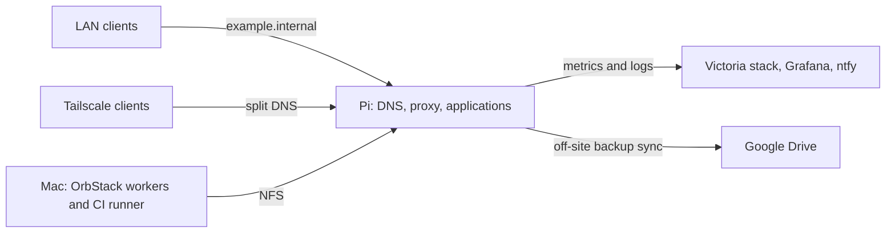

# Raspberry Pi Homelab

Ansible-managed infrastructure on a Raspberry Pi 4B (8 GB RAM, Debian 13 ARM64,
1.8 TB SSD), with Docker services on the Pi and compute workers on a Mac.

> **Public snapshot.** This repository is a reviewed snapshot of the private
> working repository the homelab is actually deployed from. A few roles that
> serve private workloads (and their tests, alerts, runtime commands and
> write-ups) are left out, and references to them were removed or generalized.
> Secrets live in an Ansible Vault that is not published; use
> [`vault.yml.example`](ansible/inventory/group_vars/all/vault.yml.example) as
> the template. The private repo's CI runs on a self-hosted runner, so no CI
> workflow is published here — run the checks locally with `make validate`.
> Addresses and names are placeholders: `192.0.2.0/24` (the RFC 5737
> documentation range) stands for the LAN, `100.64.0.x` for Tailscale nodes,
> `example.internal` for the internal domain, `raspberrypi.local` for the Pi's
> mDNS name, and `.example` / `example.org` for the retired single-label and
> `.io` domains the history mentions. Set `lan_subnet`, `lan_ip` and
> `homelab_internal_domains` in the inventory for a real host.

Start with [PROJECT_INDEX.md](PROJECT_INDEX.md) for a map of the snapshot and
the [documentation index](docs/README.md) for architecture, operations and
recovery procedures.

## Architecture



The internal domain is `example.internal`; the former `.example` and
`.example.org` names are retired. The Pi is `raspberrypi.local` / `192.0.2.100`
on the LAN and `100.64.0.10` on Tailscale. Network configuration comes from
[shared inventory variables](ansible/inventory/group_vars/all/main.yml).

Media imports preserve hardlinks through the shared `/srv` → `/data` layout.
See the [architecture](docs/design/001-architecture.md),
[service inventory](docs/design/037-service-inventory-and-relationships.md)
and [Mac worker guide](mac-worker/README.md).

## Development and initial provisioning

```bash
make dev
.venv/bin/pre-commit install --hook-type pre-commit --hook-type commit-msg --hook-type pre-push
make requirements
make validate
make help
```

Configure the Ansible inventory and encrypted vault before contacting a host.
[Development checks](docs/operations/development-checks.md) describes the locked
toolchain and prerequisites.

For a new host, `make base` provisions `common → security → storage → docker`.
Then configure networking (`tailscale → adguard → traefik`) and the required
service groups. The ML stack needs `postgresql → minio → mlflow → label-studio`.
Run `make help` for the current targets and inspect each role's defaults before
deployment.

## Changes and releases

In the private repo, changes are committed directly to `master` with
conventional commit messages. A push runs CI; production promotion uses a
`deploy-v*` tag. The Pi-side GitOps controller checks CI, previews the changed
roles with `--check --diff` and rolls back failed deployments. `base` and
`homelab-autodeploy` remain manual targets. Local `make <role>` is also the
bootstrap/recovery path.

[Operational discipline](docs/operations/ops-discipline.md) covers deploy
safety, and the [incident log](docs/incidents/README.md) records failures and
the structural fixes they produced. Local validation, remote CI and live
verification are separate evidence levels.
