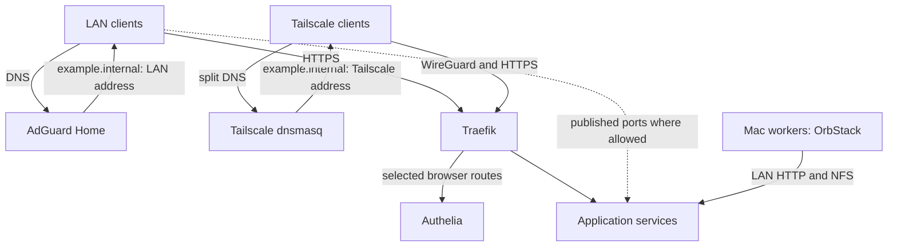
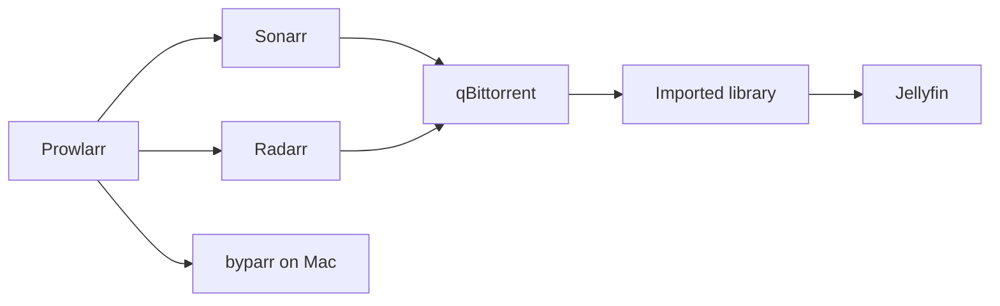
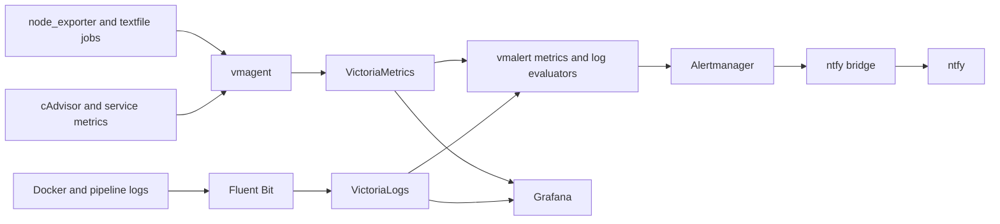
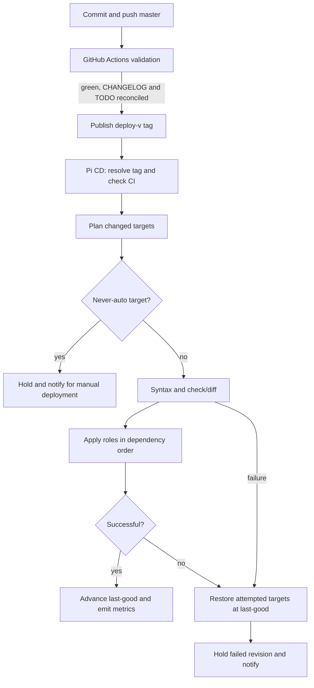

# Architecture

Topology reconciled against repository configuration on **2026-09-27**.
This combines the former architecture and diagram documents. Current runtime
observations live in [PROJECT_INDEX](../../PROJECT_INDEX.md); component ownership
is in the [service inventory](037-service-inventory-and-relationships.md).

## Infrastructure and network



The Pi uses `192.0.2.100` on the LAN and `100.64.0.10` on Tailscale.
`raspberrypi.local` is its mDNS name; internal browser services use
`<service>.example.internal`. The sole domain source is
[`homelab_internal_domains`](../../ansible/inventory/group_vars/all/main.yml).
The old `.example` and `.example.org` migration records are historical.

macOS needs a scoped resolver for `example.internal` when another resolver/VPN
owns the default DNS path. Native workers use the configured Pi LAN address.
The [Mac guide](../../mac-worker/README.md) and
[DNS runbook](../runbooks/046-2026-07-08-macos-corp-vpn-homelab-dns.md)
cover client setup. Internal HTTPS uses the local CA; trust must be installed
on each client. Jellyfin direct HTTP access remains an option for clients that
cannot trust that CA.

UFW governs host listeners; Docker-published ports also need the DOCKER-USER
policy. Container-to-host connections may require the Docker bridge subnet in
host firewall rules. Container names resolve only on shared Docker networks;
use explicit network membership or a reachable configured host endpoint.

**Forward-auth covers only traffic through Traefik.** A service with a directly
reachable published port has another entry path. Port closure must follow an
inventory and migration of API consumers. See the
[auth-boundary convention](../conventions/reverse-proxy-not-an-auth-boundary.md).

## Storage layout

```text
root SSD
├── /srv/docker                 Docker metadata and logs
├── /srv/downloads              Download sources
├── /srv/media/movies           Radarr imports
├── /srv/media/series           Sonarr imports
├── /srv/backups                Local snapshots and retained recovery artifacts
├── /srv/data                   Shared data services
├── /home/pi/docker           Live application configuration and generated assets
└── /var/lib/containerd         Image layers when using the containerd snapshotter
```

`/srv` is a directory on the root filesystem, not a separate data disk. Capacity
work must measure the whole root disk and the relevant named subtrees, including
application data outside `/srv`. Device names and utilization are observations,
not permanent architecture facts.

Media automation shares `/srv:/data`, keeping local source and import paths on
one filesystem for hardlinks. Preserve this relationship when moving storage.
Jellyfin plays media directly.
The second SSD is disabled pending powered-hub and boot acceptance;
[design 042](042-second-ssd-integration-plan.md) records the migration constraints.

Local backup snapshots and the weekly off-site `rclone sync` form the backup
pipeline. Sync mirrors the local retention set; it is not the retired encrypted
three-version plan. See [backup design](043-offsite-backup-google-drive.md)
and [restore runbook](../runbooks/028-backup-restore.md).

## Workload and observability flow





Beszel and Uptime Kuma provide additional views; Beszel sample freshness is
independently observed. Neither healthy dashboards nor successful ntfy HTTP
responses prove phone receipt. The evaluator and delivery stack still share the
Pi failure domain; independent outage detection remains open.

## Boot and provisioning

Base roles run `common → security → storage → docker`. Service roles must not
execute base provisioning through their metadata dependencies. Shared host values
belong in group vars. Networking precedes application setup; PostgreSQL and MinIO
precede their ML consumers. Containers normally use `restart: unless-stopped`;
shutdown tooling preserves restart intent. Host services have their own systemd
dependencies. The [boot runbook](../runbooks/002-boot-recovery.md)
contains recovery procedures.

## CI/CD Deploy Flow (GitOps, design 039)

A push to `master` runs CI. Production CD selects a **`deploy-v*` tag**, not every
master commit. The current allowlist is empty (all eligible changed targets), with
`base` and `homelab-autodeploy` in the never-auto list. Check the
[controller defaults](../../ansible/roles/homelab_autodeploy/defaults/main.yml)
when changing this policy.



Local `make <role>` also performs syntax/deep checks by default; it remains the
bootstrap and recovery path. An unreachable Pi can skip the deep check with an
explicit warning. `DEPLOY_DEEP_CHECK=0` skips only that check;
`DEPLOY_SKIP_CHECK=1` bypasses both. Check-mode exclusions mean previews are not
full runtime proof; static guards cover known skipped-result failures.

Controller decisions live in tested Python modules; shell orchestrates side
effects. `make cd-drill` exercises rollback/held behavior. A green local check,
a green remote CI run and a successful live deploy are separate results.
See [operational discipline](../operations/ops-discipline.md) and
[runner design 039](039-mac-ci-runner.md).
